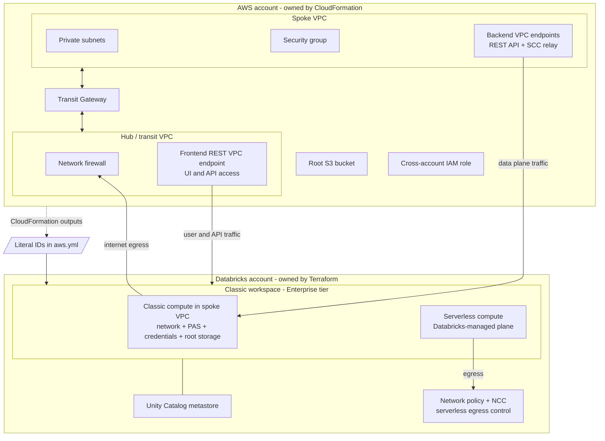
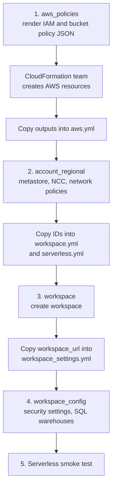

# Databricks AWS workspace Terraform

Terraform account/workspace configuration for Databricks on AWS using literal YAML configuration. Terraform manages Databricks account and workspace objects only. The AWS hub and spoke network, firewall, Transit Gateway, subnets, security groups, VPC endpoints, root bucket, and IAM roles are provisioned out of band by the CloudFormation team.

The sample is a classic (hybrid) Enterprise workspace with backend and frontend PrivateLink, SCC relay, Unity Catalog assignment, a restricted serverless egress policy, and serverless SQL.

## Architecture and ownership



| Resource | Owner | Source of Terraform input |
| --- | --- | --- |
| Hub/spoke VPCs, firewall, TGW, routes, subnets, security groups | CloudFormation | CloudFormation outputs copied into `aws.yml` |
| AWS VPC endpoints and private DNS | CloudFormation | CloudFormation endpoint IDs copied into `aws.yml` |
| Root bucket, IAM role and attached IAM policies | CloudFormation | Bucket name and role ARN copied into `aws.yml`; policy JSON is rendered by `aws_policies` |
| Databricks credentials, storage configuration, registered VPC endpoints, network, PAS, workspace | Terraform account provider | Workspace YAML plus literal AWS IDs |
| Metastore, NCCs, account network policies | Terraform account provider | `regional.yml` |
| Workspace-to-metastore assignment, NCC binding, workspace network policy, workspace access assignments | Terraform account provider | Workspace YAML and regional output IDs |
| Workspace security settings and SQL warehouses | Terraform workspace provider | `workspace_settings.yml` |

No AWS Terraform provider or CloudFormation/SSM lookup is used by these stacks. Workspace and account state use separate Terraform roots.

## Deployment order



1. **Render CloudFormation policy JSON.** `aws_policies` uses a local backend and does not need AWS credentials or account API authentication. Review and provide the generated policy files to the CloudFormation team:

   ```bash
   ./scripts/tf.sh aws_policies dev ap-southeast-1 analytics init
   ./scripts/tf.sh aws_policies dev ap-southeast-1 analytics plan
   ./scripts/tf.sh aws_policies dev ap-southeast-1 analytics apply
   ```

   Files are written under `out/<env>_<region>_<workspace>/`. The CloudFormation team applies the role policies and creates the VPCs, endpoints, routes, root bucket, and role. Copy those CloudFormation outputs as literal values into `configs/dev/ap-southeast-1/analytics/aws.yml`.

2. **Create regional account resources.** Configure the S3 state bucket in the backend file and account identity in `regional.yml`, then:

   ```bash
   ./scripts/tf.sh account_regional account ap-southeast-1 - init
   ./scripts/tf.sh account_regional account ap-southeast-1 - plan
   ./scripts/tf.sh account_regional account ap-southeast-1 - apply
   ```

   Copy the `metastore_id`, NCC ID, and network-policy ID outputs into `workspace.yml` and `serverless.yml`. For an existing metastore, set `metastore.create: false` and supply its `metastore_id`; the stack then creates no metastore.

3. **Create the workspace.** Set account OAuth environment variables and fill every literal value:

   ```bash
   export DATABRICKS_CLIENT_ID="<account-service-principal-client-id>"
   export DATABRICKS_CLIENT_SECRET="<account-service-principal-client-secret>"
   ./scripts/tf.sh workspace dev ap-southeast-1 analytics init
   ./scripts/tf.sh workspace dev ap-southeast-1 analytics plan
   ./scripts/tf.sh workspace dev ap-southeast-1 analytics apply
   ```

   The account service principal must have account-admin privileges. Capture `workspace_url` from the output.

4. **Configure the workspace.** Set `workspace_url` in `workspace_settings.yml`, configure the workspace backend state, and run:

   ```bash
   ./scripts/tf.sh workspace_config dev ap-southeast-1 analytics init
   ./scripts/tf.sh workspace_config dev ap-southeast-1 analytics plan
   ./scripts/tf.sh workspace_config dev ap-southeast-1 analytics apply
   ```

5. **Smoke test serverless.** From a machine that can route to the workspace host, run the script using an existing serverless SQL warehouse:

   ```bash
   DATABRICKS_HOST="https://<workspace-host>" \
   DATABRICKS_TOKEN="<token>" \
   ./scripts/smoke_test_serverless.sh --warehouse-name serverless-default
   ```

   The script checks an existing serverless SQL warehouse when one exists, then imports a temporary Python notebook, submits an ephemeral serverless one-time run (no saved job), waits for success, and deletes the notebook on exit. It never creates a SQL warehouse or a persistent job.

`scripts/tf.sh` always uses the matching `terraform.tfvars` and backend file. Account regional usage is `<stack> account <region> - <action>`. Each S3 backend file is intentionally partial; set its bucket and retain `use_lockfile = true`. AWS credentials are needed only for those S3 state backends. The `aws_policies` stack has a local state file and no S3 backend.

## YAML reference

The loader reads and merges every `*.yml` in the stack's environment/region/workspace folder. Top-level keys must be unique across files; a precondition fails planning on duplicates. `terraform.tfvars` selects the environment, region, and workspace folder. The usable, non-secret sample config is in `configs/`; replace all example IDs, role names, and bucket values before applying. Templates with CloudFormation output mappings are under `sample_config_templates/`.

### Account regional: `configs/account/<region>/regional.yml`

| Key | Purpose |
| --- | --- |
| `databricks_account_id` | Databricks account UUID used by the account provider |
| `region` | AWS/Databricks region; must match the stack argument |
| `metastore.create` | Create one metastore in this region when true |
| `metastore.name`, `owner`, `storage_root` | Creation settings; `storage_root` is optional |
| `metastore.metastore_id` | Existing metastore UUID when `create: false` |
| `network_connectivity_configs[]` | Regional NCC name and optional AWS private endpoint rules |
| `network_policies[]` | Egress mode, enforcement mode, DNS allow-list, and S3 bucket/region allow-list |

### Workspace folder: `configs/<env>/<region>/<workspace>/`

| File / top-level key | Purpose |
| --- | --- |
| `workspace.yml` / `databricks_account_id` | Account UUID |
| `workspace.yml` / `workspace` | Workspace name, optional deployment name, AWS region, custom tags |
| `workspace.yml` / `private_access` | Public access flag and PAS access level (`ACCOUNT` or `ENDPOINT`) |
| `workspace.yml` / `unity_catalog` | Existing or newly created regional metastore ID |
| `aws.yml` / `aws` | AWS account, cross-account role, root bucket, VPC, subnets, SGs, and all three endpoint IDs |
| `serverless.yml` / `serverless` | Optional NCC ID and network policy ID; defaults to `default-policy` |
| `access.yml` / `workspace_access` | Deployment service-principal application ID (always `ADMIN`), groups, users, and service principals (`USER` or `ADMIN`) |
| `workspace_settings.yml` / `workspace_url` | Workspace host from the workspace stack output |
| `workspace_settings.yml` / `security` | Optional compliance profile, enhanced monitoring, and legacy-feature flags |
| `workspace_settings.yml` / `sql_warehouses` | SQL warehouse names, sizes, autoscaling, and auto-stop values |

The workspace module deliberately leaves `compute_mode` unset: credentials, root storage, and the Databricks VPC network are configured for a classic/hybrid workspace. It always uses Enterprise tier and enables SCC/no-public-IP.

## Tests and tooling

Terraform `>= 1.10.0` is required for S3 state locking with `use_lockfile`. The Databricks provider constraint is `>= 1.81.0, < 2.0`: provider CHANGELOG release `v1.81.0` is the first release listing both `account_network_policy` and `workspace_network_option`. Provider lock files are committed for Linux amd64 and macOS arm64/amd64.

Run the checks from the repository root:

```bash
terraform fmt -recursive -check
for stack in aws_policies account_regional workspace workspace_config; do
  (cd "stacks/$stack" && terraform init -backend=false && terraform validate)
done
(cd modules/composite/aws_privatelink_workspace && terraform init -backend=false && terraform test)
(cd modules/account/mws_private_access_settings && terraform init -backend=false && terraform test)
for stack in aws_policies account_regional workspace workspace_config; do
  terraform test -chdir="stacks/$stack"
done
```

`aws_policies` can be planned without credentials and has a Terraform test for its JSON outputs. A local-only apply writes the JSON artifacts for CloudFormation review.

## Operational notes and gotchas

- With `public_access_enabled: false`, the workspace UI/API is private-only. The Terraform runner for `workspace_config` and the smoke test must reach the workspace via the frontend REST endpoint and private DNS.
- The account network policy controls serverless-compute egress only. It does not route classic workspace traffic through the hub firewall; the firewall controls that network path.
- Start with `enforcement_mode: DRY_RUN`, review violations, then switch to `ENFORCED`. The provider/API enum documented for `policy_enforcement.enforcement_mode` is `DRY_RUN` or `ENFORCED`.
- Workspace `custom_tags` cannot be removed completely after they are applied. Plan tag changes carefully.
- Provider docs say only credentials, network, private access settings, storage customer-managed key, and custom tags are updatable on a running AWS workspace. Treat workspace identity/storage setup as replacement-sensitive.
- AWS Network Connectivity Config private endpoint rules are Preview on AWS. Their endpoints may require approval before they are usable.
- Databricks supports one Unity Catalog metastore per region. Choose the existing/create path deliberately before applying regional resources.
- Account auth uses `DATABRICKS_CLIENT_ID` and `DATABRICKS_CLIENT_SECRET` from an account-admin service principal. Do not store these in Terraform variables, YAML, or state.
- S3 backend AWS credentials are needed only for the stacks using the S3 backend. The AWS policy renderer uses a local backend.
- Unity Catalog catalogs, schemas, grants, and other data assets are a separate next phase. This repository currently covers workspace/account provisioning only; it does not yet include the UC assets layer from the existing project.
